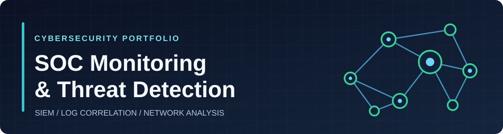
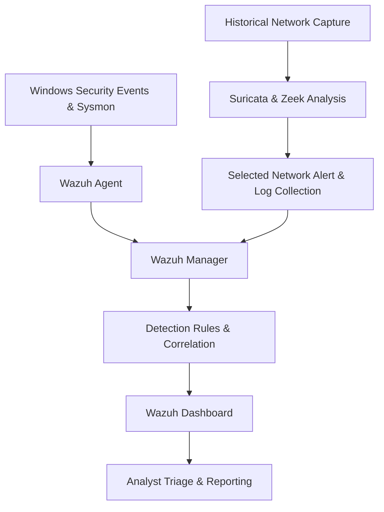
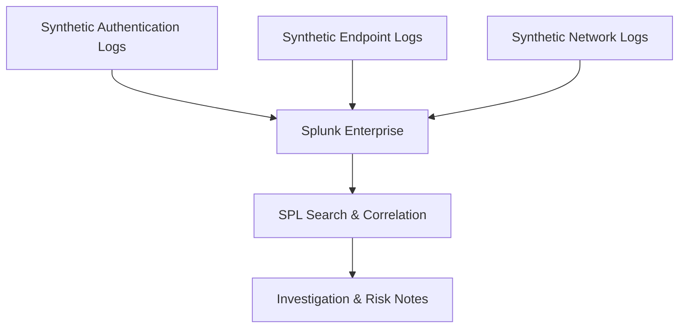

# SOC Monitoring & Threat Detection

**Security operations • Event correlation • Network analysis • Detection engineering**

> A curated set of authorized training investigations from my Junior Cybersecurity Analyst internship at EncryptEdge Labs, complemented by a **new, fictional Python and Sigma detection demonstration** prepared specifically for this portfolio.

[← Back to Cybersecurity Portfolio](../README.md) · [View code](log_analyzer.py) · [View tests](test_log_analyzer.py) · [View Sigma rule](sigma/windows_failed_logon_burst.yml)

---

## At a glance

| | |
|---|---|
| **Focus** | SOC monitoring, alert triage, detection development, incident investigation |
| **Platforms** | Wazuh, Splunk, Elasticsearch/Kibana, Sysmon, Suricata, Zeek, Wireshark |
| **Lab systems** | Windows 10, Ubuntu Linux, VMware Workstation, Docker |
| **Independent demo** | Python 3 failed-login analyzer + synthetic CSV + Sigma correlation rule |
| **Validation** | 17 automated Python tests passed; Sigma YAML parsed and structure checked |
| **Scope** | Authorized laboratories and historical or fictional datasets; no production SOC activity |

## What I worked on

### 01 · Authentication monitoring and alert triage

**Challenge:** Separate repeated authentication failures and privileged-logon indicators from routine event noise.

**My work:** Configured Windows log collection and Sysmon/Wazuh monitoring in a virtual lab. Investigated Windows Security Event IDs **4625** (failed logon) and **4672** (special privileges assigned), and tested custom alerting and correlation rules.

**Outcome:** Verified a training detection that raised an alert for three failed logons in 60 seconds and examined privileged-logon alerts. These observations indicated activity for investigation, **not proof of compromise**.

### 02 · SIEM correlation with Splunk

**Challenge:** Understand how isolated endpoint, authentication, and network events become meaningful when examined together.

**My work:** Ingested a controlled **synthetic** dataset into Splunk Enterprise, used SPL searches to correlate event fields and investigated potential event sequences.

**Outcome:** Practiced evidence-based alert triage and documented how event context affects interpretation. The Splunk exercise was **separate** from the Wazuh monitoring environment.

### 03 · Network incident investigation and detection tuning

**Challenge:** Assess suspicious network activity and determine whether an additional detection could improve coverage of a specific observed pattern.

**My work:** Examined an offline historical capture with Suricata, Zeek, and Wireshark; correlated IDS alerts with HTTP and connection records; tested a custom detection during a controlled replay; and verified a resulting Wazuh test alert.

**Outcome:** In the documented lab replay, a baseline of **51 Suricata alerts** increased to **164** after adding the training-specific detection. This is an **alert-count comparison for one historical capture**, not a measured improvement in accuracy or a confirmed malware infection.

> The three studies above are summaries of **separate** training exercises. Original task solutions, case datasets, and internal reports are intentionally not published.

---

## Monitoring workflows

These diagrams illustrate the concepts used in the exercises—not an exact infrastructure diagram and not a claim that all tools were connected in one deployment.

### Wazuh-centered monitoring lab



### Separate Splunk exercise



---

## Independent detection demonstration

To demonstrate the underlying detection concepts without publishing internship solutions, this portfolio includes a **standalone educational example** that identifies repeated failed sign-ins from the same source IP.

| File | Purpose |
|---|---|
| [`log_analyzer.py`](log_analyzer.py) | Reads fictional authentication events and applies a 60-second sliding window |
| [`test_log_analyzer.py`](test_log_analyzer.py) | Automated tests for detection, boundaries, bad input, and command-line operation |
| [`data/synthetic_auth_events.csv`](data/synthetic_auth_events.csv) | Fictional test data using documentation-only IP ranges |
| [`sigma/windows_failed_logon_burst.yml`](sigma/windows_failed_logon_burst.yml) | Experimental Sigma base selector and event-count correlation rule |
| [`docs/VALIDATION.md`](docs/VALIDATION.md) | Reproducible run commands, observed results, limitations, and Sigma validation status |

### Try the Python example

Requires **Python 3.10+**. No external packages, SIEM credentials, or network access are needed.

From this project directory:

```bash
python log_analyzer.py
python -m unittest -v test_log_analyzer.py
```

Example output from the supplied fictional CSV:

```text
[ALERT] 192.0.2.10: 3 failed logins between 2026-10-01T10:00:00Z and 2026-10-01T10:00:50Z
Analysis complete: 1 source(s) flagged.
```

The script groups by **source IP**, sorts events before evaluation, excludes successful logins, and generates **one demonstration alert per IP**. It is not intended to replace a production SIEM or determine whether an attack occurred.

### Sigma rule

The example Sigma file models Windows Security **Event ID 4625** plus a correlation for **at least three events per source IP in one minute**. The base selector and correlation are stored together in a two-document YAML file. Refer to the [official Sigma correlation specification](https://sigmahq.io/docs/meta/correlations.html).

**Important:** A Sigma backend may aggregate into fixed time buckets, whereas the Python example uses a true sliding window. The two are *similar detection ideas*, not guaranteed identical implementations. The YAML has been syntax-checked; it has **not** been deployed or tested against a production SIEM. Read [validation details](docs/VALIDATION.md) before reuse.

---

## Lessons and limitations

- **Context matters:** An alert is a lead for investigation, not itself confirmation of malicious activity.
- **Tuning matters:** More alerts do not necessarily mean better security; false positives and detection coverage must be evaluated.
- **Data quality matters:** Real Windows Security events do not always include a usable source IP; field mappings vary by collector and SIEM backend.
- **Reproducibility matters:** Independent tests and clear scope statements make portfolio demonstrations more useful to reviewers.

## Responsible publication

This repository contains **original public-facing summaries and fictional educational examples** prepared with AI-assisted drafting and local testing. It deliberately excludes confidential internship reports, internal templates, full assessment solutions, credentials, raw sensitive evidence, and malware binaries. It does not represent deployment in an operational organization.

**Portfolio author:** Deva Singh Rasaputra · [LinkedIn](https://www.linkedin.com/in/devasingh-rasaputra/) · [Portfolio home](../README.md)
