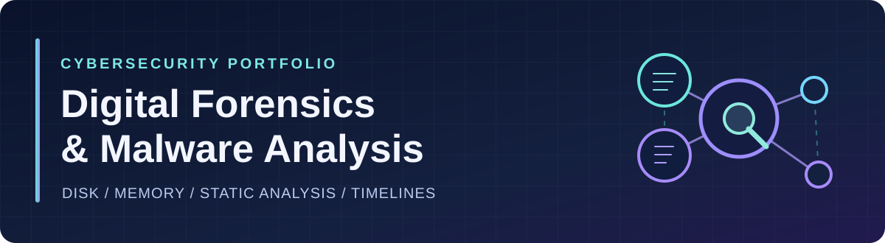
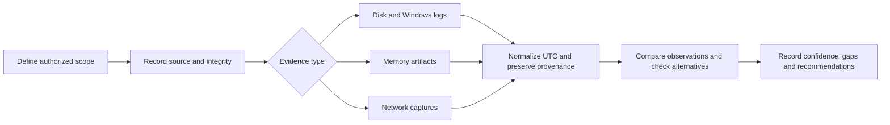

<p align="center">
  
</p>

# Digital Forensics & Malware Analysis

**Evidence preservation · Host and memory forensics · Static malware analysis · Timeline reconstruction**

> Selected, high-level investigations from my Junior Cybersecurity Analyst Internship at **EncryptEdge Labs**, accompanied by **new, independently created demonstrations** built for this portfolio. These were authorized training exercises, **not production incidents**.

[← Portfolio home](../README.md) · [Timeline demonstration](examples/timeline_triage.py) · [SHA-256 verifier](examples/verify_evidence.py) · [Tests](tests/) · [Validation notes](docs/VALIDATION.md)

---

## At a glance

| | |
|:--|:--|
| **Focus** | Forensic artifacts, endpoint investigation, network/malware triage, evidence integrity |
| **Tools practiced** | FTK Imager, Autopsy, Volatility 3, Sleuth Kit, Plaso, REMnux, YARA, INetSim, Wireshark, TShark |
| **Lab environments** | Windows, Ubuntu Linux, VMware Workstation; historical and controlled training data |
| **Independent demo** | Python timeline-lead correlation + SHA-256 integrity verification on inert files |
| **Verification** | 29 local Python unit tests passed; reproducible commands in [VALIDATION.md](docs/VALIDATION.md) |
| **Boundaries** | No malware binaries, raw forensic images, credentials, restricted evidence, or internship solutions |

## Selected investigations

### 01 · Disk evidence and Windows memory

**Challenge.** Establish useful host context while keeping distinct forensic data sources separate and protecting source evidence.

**What I did.** Examined a Windows forensic image with **FTK Imager** and exported selected Windows event logs for offline review. In a separate exercise, used **Autopsy** to examine a read-only NTFS test image and verify its integrity. Used **Volatility 3** to review processes, network artifacts, and possible persistence indicators in Windows memory; interpreted available event logs alongside process timestamps.

**Outcome.** Built familiarity with image examination, artifact extraction, process triage, and the importance of integrity checks. Several potentially suspicious observations required follow-up; limited or incomplete event-log coverage prevented definitive attribution.

**Key lesson:** An interesting process, memory region, or network artifact is an *investigative lead*, not proof of malware or intrusion.

### 02 · Malware traffic and static executable analysis

**Challenge.** Analyze suspicious file delivery and network behavior safely without assuming that a suspicious transfer establishes malicious execution.

**What I did.** Worked in a disconnected **REMnux** environment; examined a historical network capture with **Wireshark/TShark**; recovered a transferred Windows executable for **static, non-executing** analysis of file type, hashes, metadata, and strings. Created and tested a **sample-specific YARA** rule. Separately verified that **INetSim** could receive a harmless simulated HTTP request.

**Outcome.** Documented candidate indicators and detection limitations, while explicitly distinguishing suspicious traffic from confirmed command-and-control activity. **The recovered executable was not run**; INetSim testing was not a malware execution experiment.

**Key lesson:** Static indicators and network context can prioritize investigation, but they do not establish runtime behavior by themselves.

### 03 · Multi-source timeline and incident reporting

**Challenge.** Reconcile disk, memory, and network observations without creating an unsupported single attack narrative.

**What I did.** Used **Plaso (log2timeline/psort)** to build a large historical forensic timeline, examined Windows event records, investigated network traffic with **Wireshark**, and reviewed memory process/network artifacts using **Volatility 3**. Recorded time-zone handling, evidence integrity, parser warnings, candidate indicators, and confidence limits in a structured investigation report.

**Outcome.** Produced an evidence-informed chronology and remediation recommendations. Timeline extraction covered **over one million records**, but warnings and gaps in the source data were documented; a complete attack chain was **not** independently established.

**Key lesson:** Cross-source correlation is strongest when every inference can be traced to an artifact and its limits are recorded.

---

## Forensic workflow: how I approach an investigation



*Conceptual workflow only: the individual training exercises used different datasets, and the diagram is not a claim that all tools ran together on one incident.*

## Independent technical demonstrations

These examples are **new, fictional exercises**, not exported source code or final solutions from EncryptEdge Labs tasks. No malware or external access is required.

| Demonstration | What it demonstrates | Files |
|:--|:--|:--|
| **Forensic timeline triage** | Normalizes UTC timestamps, groups records by case and host, and identifies **candidate** temporal relationships between process, autorun, and network events | [Script](examples/timeline_triage.py) · [Fictional CSV](data/synthetic_timeline.csv) · [Tests](tests/test_timeline_triage.py) |
| **Evidence integrity** | Calculates SHA-256 and compares inert files against a manifest; detects modified files and rejects unsafe manifest paths | [Script](examples/verify_evidence.py) · [Manifest](data/SHA256SUMS.txt) · [Tests](tests/test_verify_evidence.py) |

### Try the examples

Requires **Python 3.10+**, with **no external Python packages**. Run these commands from the `02-digital-forensics-malware-analysis` folder:

```bash
python examples/timeline_triage.py --input data/synthetic_timeline.csv
python examples/verify_evidence.py --root . --manifest data/SHA256SUMS.txt
python -m unittest discover -s tests -v
```

**Example timeline result:** The fictional dataset produces **two leads for analyst review**. Leads are based on timestamps within a configurable window. **No conclusion about compromise is made.** See [validated output and limits](docs/VALIDATION.md).

### Evidence integrity and interpretation

Forensic reliability depends on *how* material is collected and interpreted, not on the quantity of artifacts alone. Read the [evidence-handling and reasoning notes](docs/FORENSIC_NOTES.md) for the assumptions built into these demonstrations.

---

## Skills demonstrated

**Forensic workflow:** evidence integrity, source preservation, Windows event artifacts, memory triage, UTC timeline analysis, IOC prioritization, structured reporting.

**Malware investigation:** static inspection, network traffic review, sample-specific signatures, separation of observed indicators from unverified behavior.

**Technical implementation:** Python, CSV parsing, hash verification, defensive input handling, unit testing, Markdown, Mermaid.

## Scope, credit, and responsible sharing

- The historical investigations were performed in **authorized learning environments** during the internship. The summaries above describe my role and learning outcomes; original reports, assessment answers, raw logs, forensic images, memory dumps, and malware samples are **not** published here.
- The Python scripts, fictional dataset, and diagrams are **independent educational examples** created for this portfolio. They do not claim to reproduce a particular real incident or a proprietary lab solution.
- Observed proximity between events is **not causal proof**. Hash equality demonstrates file consistency with a recorded digest, **not** authenticity of evidence or completeness of chain of custody.
- All IP addresses in the fictional dataset use documentation-only address ranges. No credentials, private data, or company systems are needed to run the scripts.

**Author:** Deva Singh Rasaputra · [GitHub profile](https://github.com/DevaR36) · [LinkedIn](https://www.linkedin.com/in/devasingh-rasaputra/)
