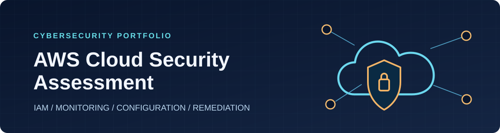

<p align="center">
  
</p>

# AWS Cloud Security Assessment

**Identity & access · Audit logging · Security configuration · Verified remediation**

> Selected, high-level AWS security exercises performed in an **authorized personal lab** during my Junior Cybersecurity Analyst Internship at **EncryptEdge Labs**, accompanied by a **new, independent offline training demonstration**. These are lab assessments, **not claims of production security work or confirmed breaches**.

[← Portfolio home](../README.md) · [Offline posture analyzer](examples/posture_audit.py) · [Synthetic snapshots](data/) · [Automated tests](tests/test_posture_audit.py) · [Validation notes](docs/VALIDATION.md)

---

## At a glance

| | |
|:--|:--|
| **Focus** | IAM permissions, cloud monitoring, misconfiguration assessment, risk prioritization and remediation |
| **Services configured or reviewed** | AWS IAM, EC2/EBS, S3, CloudTrail, AWS Config |
| **Tools practiced** | Scout Suite 5.14.0, AWS CLI, AWS CloudShell, Microsoft Excel |
| **Training assessment** | **243** check results reviewed; **22** initially flagged, **20** after two verified improvements |
| **Independent demo** | Offline Python posture checker over fictional JSON snapshots; no AWS API access |
| **Validation** | Automated Python unit tests and reproducible steps in [VALIDATION.md](docs/VALIDATION.md) |
| **Boundaries** | No credentials, real account configuration exports, restricted evidence or production assessments |

## What I worked on

### 01 · AWS logging and access-control foundation

**Challenge:** Establish account-level visibility while limiting administrative exposure in a personal training environment.

**My work:** Reviewed IAM identities and policy assignments, enabled root MFA, configured CloudTrail for multi-Region management-event logging and log-file validation, and enabled AWS Config continuous recording. Used AWS CLI and CloudShell to verify selected settings.

**Outcome:** Confirmed CloudTrail management-event delivery and recorded an operational AWS Config setup. The Config dashboard also showed some permission-related recording errors; I documented this gap instead of treating recording as complete. The lab did not establish any real-world compromise.

### 02 · Automated cloud security assessment

**Challenge:** Translate scanner output into a useful, evidence-based prioritization rather than assuming that every flagged item meant an exploitable vulnerability.

**My work:** Ran **Scout Suite v5.14.0** from CloudShell across IAM, EC2, S3 and CloudTrail. Reviewed the output, categorized configuration and monitoring gaps, and consolidated observations into a 12-item risk assessment with suggested improvements.

**Outcome:** The initial assessment reviewed **243 check results**, identifying **22 flagged results** (7 danger-level and 15 warning-level results, according to Scout Suite). Findings included authentication, encryption, access logging and storage control opportunities. The assessed S3 log buckets had Block Public Access enabled; the investigation did not demonstrate any public bucket exposure.

### 03 · Remediation and rescan verification

**Challenge:** Show that targeted security changes improve the measured configuration without overstating their impact.

**My work:** Enabled passkey MFA for a lab IAM user and EBS encryption by default for the assessed AWS Region, verified both through AWS CLI, and repeated the same Scout Suite assessment scope.

**Outcome:** Flagged check results decreased from **22 to 20**. The remaining **20** were not all resolved; the count alone does not measure attack risk or demonstrate security-framework compliance.

| Internship assessment measurement | Before | After |
|:--|--:|--:|
| Scout Suite flagged check results | 22 | 20 |
| IAM flagged check results | 6 | 5 |
| EC2 flagged check results | 5 | 4 |
| Verified configurations changed | — | IAM user MFA; default EBS encryption |

**Interpretation:** This was a **9.1% reduction in flagged checks**, not a claim that overall security improved by 9.1%.

## Assessment-to-remediation workflow

This diagram is a **conceptual summary**, not an exact exported architecture of the AWS lab.

```mermaid
flowchart LR
  A["Authorized AWS Lab"] --> B["Review IAM and Security Logging"]
  B --> C["Scout Suite Assessment"]
  C --> D["Manually Validate Findings"]
  D --> E["Prioritize Risk and Controls"]
  E --> F["Implement Selected Changes"]
  F --> G["Verify with AWS CLI"]
  G --> H["Rescan Same Scope"]
  H --> I["Document Resolved and Open Findings"]
```



## Independent technical demonstration

To demonstrate the **logic of control reviews** without publishing internship assessment solutions, I built a separate, offline Python example. It reads **fictional JSON snapshots** and checks 11 simple, explicitly modeled controls related to authentication, encryption, storage and logging.

| File | Purpose |
|:--|:--|
| [`examples/posture_audit.py`](examples/posture_audit.py) | Self-contained Python control checker with before/after comparison and JSON output |
| [`data/fictional_before.json`](data/fictional_before.json) | Fictional baseline snapshot — no AWS resource IDs or secrets |
| [`data/fictional_after.json`](data/fictional_after.json) | Fictional follow-up snapshot with two example improvements |
| [`tests/test_posture_audit.py`](tests/test_posture_audit.py) | Tests for results, comparisons, missing fields, data types and CLI behavior |
| [`docs/VALIDATION.md`](docs/VALIDATION.md) | Reproducible commands, expected output and limitations |
| [`docs/ASSESSMENT_CHECKLIST.md`](docs/ASSESSMENT_CHECKLIST.md) | Reviewer-friendly cloud security checklist |
| [`docs/SECURITY_NOTES.md`](docs/SECURITY_NOTES.md) | Responsible-sharing and scope boundaries |

### Try the offline demo

Requires **Python 3.10+**, with **no external packages**, AWS account, network access or credentials.

From the `03-aws-cloud-security` directory:

```bash
python examples/posture_audit.py data/fictional_before.json data/fictional_after.json
python -m unittest discover -s tests -v
```

The **fictional** control checker has 11 modeled checks. It flags 5 in its baseline example and 3 afterward, because the MFA and EBS fields change. **These synthetic numbers are not the Scout Suite results** above.

## Key lessons

- Automated cloud assessment results require manual context and evidence before treating a finding as an urgent vulnerability.
- A strong assessment distinguishes **enabled controls** from **verified coverage and effectiveness**.
- Improvements should be verified with an independent method and the same baseline assessment scope.
- Cloud security involves identity, monitoring, encryption, storage governance and clear documentation—not just tools.
- Scope limitations matter: enabling EBS default encryption does not affect existing volumes retroactively; an enabled AWS Config recorder can still have collection gaps.

For details, see the [assessment checklist](docs/ASSESSMENT_CHECKLIST.md) and [security and publication notes](docs/SECURITY_NOTES.md).

## Responsible disclosure and portfolio scope

This repository includes **original summaries and fictional demonstrations**, not confidential EncryptEdge Labs reports or complete assignment solutions. No real AWS credentials, account identifiers, IAM policy exports, scanned infrastructure inventory or raw Scout Suite results are distributed. The independent Python demonstration **does not query AWS** and is not a replacement for Scout Suite, an AWS security assessment or a compliance audit.
